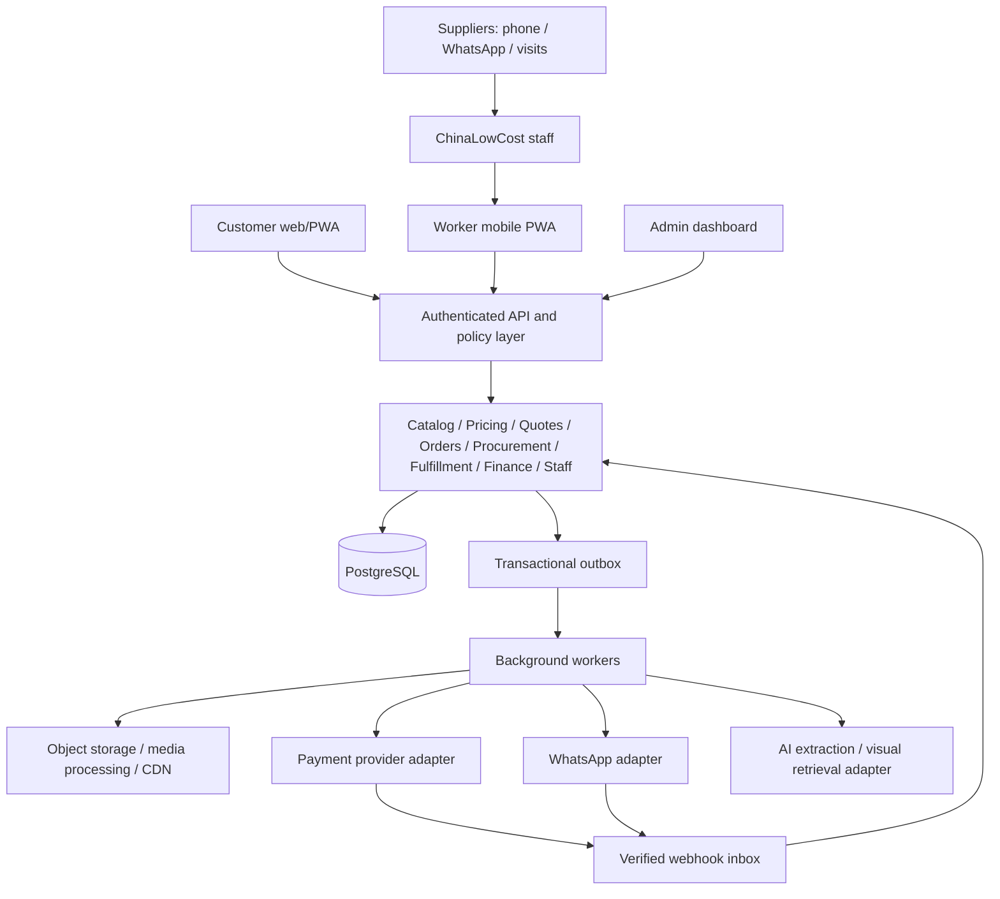

# ChinaLowCost — Application architecture and design

Version 1.4 · 15 October 2026 · Editable product and engineering specification

**Account separation update:** Accounts-and-Access-Guide.md adds separate customer/worker/admin sessions, customer signup, approval-gated worker signup, invitation-only admin signup, password changes and recovery. Signed-in account identity replaces sample worker/reviewer impersonation controls. The prototype now has 86 routes. Browser-local account checks demonstrate behavior; trusted production authentication and authorization still require the backend.

**Worker/admin parity update:** Worker-and-Admin-Operations.md connects multi-image/video capture, category specifications, quality declarations, pricing, media rights, independent publication, teams, assigned work and consent-based worker check-ins. The register now has 76 pages. Approved staff catalog versions and attached session images appear in customer views; operational order views include destination, discounts and transportation. File storage and tracking remain browser-local demonstrations.

**Catalog expansion:** Catalog-Categories-and-Product-Design.md adds 32 departments, including vehicles and auto parts, richer specifications and three-image galleries, design/price/grade/condition filters, and specialist quotation handling. Product-specific MOQ and tier thresholds supersede the earlier universal sample rules. The preview contains 33 illustrative products, with supplier-declared quality distinguished from inspection evidence.

**Location and promotion update:** the prototype now supports all 36 Nigerian states plus the FCT, representative town suggestions and custom town entry, destination/weight-based transportation estimates, product and transportation promo discounts, and dedicated administration screens. The detailed rules and data additions are in Location-Delivery-and-Promotions.md. These supersede the Lagos-only address and flat sample delivery assumptions below. The screen register now contains 69 pages. All sample transport fees and offers are illustrative.

## 1. Product agreement and scope

ChinaLowCost sells Chinese suppliers’ goods already located in Nigeria through one centrally operated business. Customers buy from ChinaLowCost. Staff contact suppliers, visit premises, capture photos and videos, record goods, procure ordered stock, arrange delivery, collect customer payments, and settle suppliers. Suppliers have **no accounts, passwords, portals, or direct access to orders**. Supplier communications are recorded by staff.

Confirmed requirements: retail and wholesale sections; wholesale calculator; downloadable quotations; AI photo search; AI-assisted catalog creation; video commerce and social promotion; customer tracking; worker application; admin dashboard; staff approval; AI and WhatsApp integrations. These remain in scope even where staged in the roadmap.

The earlier conversation’s assistant answers could not be recovered as readable text. Rules below are proposed defaults, not claims of previously agreed decisions. This is a design package, not a deployed application or final visual identity.

### Proposed operating defaults

| Topic | Default and consequence |
|---|---|
| Launch footprint | Nigeria-wide address selection; actual service coverage depends on configured state/town delivery zones and verified carrier routes |
| Currency | NGN; store all money as integer kobo; currency stored explicitly |
| Customer channels | Responsive customer web/PWA first; shared API permits later native applications |
| Worker channel | Mobile PWA with camera capture, resumable uploads, task queues and offline drafts |
| Wholesale | Quantity-tier pricing by SKU/variant; minimum quantity and pack multiples configured per item |
| Stock | Supplier-reported availability is provisional until staff reconfirm; distinguish owned stock |
| Payment | Prepayment by hosted payment checkout or verified bank transfer; controlled pay-on-delivery option |
| Supplier settlement | Pay according to recorded agreement: deposit, pickup payment, or approved credit terms; do not assume every supplier waits for delivery |
| Staff approval | Manager approval required to activate staff; permissions then granted by role and assignment |
| Catalog approval | Staff draft → reviewer approval → publication; AI never publishes |
| Quotations | Proposed 24-hour validity; price snapshot; no stock reservation until converted and confirmed |
| Tax and policies | Configurable; accountant/legal review before launch; no fixed tax-rate assumption in this design |

## 2. Experience and information architecture

Customer navigation: Home · Categories · Videos · Orders · Account. Wholesale mode is visible in header and product pages, not a separate account requirement. Search supports text and photo input. Every product shows variant, unit/pack basis, retail price, wholesale tiers, availability freshness, delivery eligibility, and ChinaLowCost support.

Worker navigation: Tasks · Capture · Pickups · Deliveries · Profile. Assigned workers see only relevant suppliers, customers and orders. Finance access is separate from logistics access.

Admin navigation: Overview · Catalog · Suppliers · Sales/Quotes · Procurement · Fulfillment · Finance · Customers · Staff/Approvals · Content · Integrations · Reports · Settings/Audit.

### Customer journeys

1. Retail: discover product or video → select variant → confirm quantity → cart → address/zone → stock check → final total → payment → tracking → receipt → support/return.
2. Wholesale: choose wholesale mode → calculator → select eligible variants and quantities → inspect tier savings → download quotation or request negotiated quote → staff review if needed → accept valid version → availability confirmation → checkout.
3. Photo discovery: upload/capture item → permission and processing notice → suggested catalog matches with similarity wording → choose verified SKU → ordinary checkout. A photo never creates a guaranteed product match.
4. Social commerce: social video/product link → app video/product detail with campaign attribution → cart or WhatsApp inquiry → staff-assisted draft order → customer confirms secure checkout.
5. Tracking: order detail shows milestone timeline, shipment splits, estimated window, exception reason, support action and last update. Map location is only shown if actually supplied by a courier and appropriately authorized.

### Design system direction

Use the ChinaLowCost wordmark with deep forest green navigation and primary actions, soft ivory and sage surfaces, lime accents and green success states. The redesigned blueprint uses custom vector product illustrations, a spacious hero, categorized product cards, a photo-search entry point and a video-commerce banner. Product illustrations and prices are sample content. Verify contrast in final design. Use consistent currency formatting (₦12,500.00), clear pack labels, large touch targets, labeled icons, keyboard access, readable text and accessible status announcements. Never communicate state through color alone.

On low-bandwidth connections load product thumbnails first; videos require user playback, have posters and captions, and offer compressed versions. Preserve carts and upload drafts on interruption. Every screen must specify loading, empty, offline, error, permission-denied and success states where relevant.

## 3. Screen requirements

The companion CSV is the editable screen register. The HTML blueprint illustrates selected layouts and navigation; the register covers the full system.

### Critical screen layouts

**Product detail:** image/video gallery; product title; verified attributes; variant selector; availability checked timestamp; retail/wholesale switch; tier table; quantity and pack multiple; calculator summary; delivery estimate; Add to cart; Download quote; Ask on WhatsApp. Hide supplier identity and purchase costs from customers.

**Wholesale calculator:** editable quantity per variant, pack size, applicable tier and unit rate; subtotal, approved discount, delivery estimate, tax line when configured, total and estimated savings against current retail reference. Show assumptions and quote expiry. If delivery cannot be calculated, label total “goods subtotal” and require delivery confirmation before payment.

**Tracking:** order reference; payment summary; event timeline; each shipment and items; expected delivery window; exception banner; contact support; delivery verification. Customer labels simplify internal states without claiming an uncompleted milestone.

**Worker capture:** assigned supplier visit; photo/video capture; AI extract button; original image beside editable suggestions; variant/pack/price/availability fields; consent evidence; Save draft; Submit for review. Prices and safety claims require human verification.

**Admin order detail:** customer and address; immutable priced lines; payment ledger; fulfillment groups; availability freshness; supplier allocations; tasks; communications; audit timeline; permitted actions with approval gates.

**Approval queue:** type, requester, reason, amount/risk, evidence, before/after changes; Approve/Reject with comment. A request’s approver cannot be its requester. Execution rechecks authorization and current object version.

## 4. Wholesale pricing and quotations

Proposed tier model is all-units pricing per variant: for quantity q, choose highest eligible minimum quantity whose range contains q, and multiply that tier’s price by q. Do not combine variants to unlock a tier unless an explicit grouping rule exists. Validate q ≥ MOQ and q modulo pack_multiple = 0. Different price models must be versioned rather than silently substituted.

Illustrative example only: retail ₦5,000/unit; 10–49 units ₦4,500; 50+ units ₦4,000; MOQ 10; pack multiple 5. Quantity 55 → goods ₦220,000. Delivery ₦8,000 → ₦228,000 before any configured tax. Retail-reference savings ₦55,000. Quantity 52 is rejected with a suggestion to use 50 or 55. Quantity 45 is ₦202,500; quantity 50 is ₦200,000, so explicitly show the tier benefit without auto-increasing the order.

Calculate on server; client estimates are informational. Version price books and effective dates. Store quotes as immutable versions with quote number, customer/business details, SKU/variant, unit and pack basis, quantities, unit prices, discounts, goods subtotal, delivery status/amount, tax breakdown, total, currency, validity, terms and staff sign-off. Render a downloadable PDF from the authoritative version and keep its file hash. This runtime quote PDF is a required app feature; no real customer quote is fabricated in this package.

Quote lifecycle: DRAFT → REVIEW_PENDING → ISSUED → ACCEPTED → CONVERTED; alternatives REJECTED, EXPIRED, SUPERSEDED. Ordinary policy-compliant quotes may issue automatically; negotiated discount or credit requires approval. Acceptance does not imply stock reservation or payment. Conversion is idempotent, rechecks expiry and availability, and creates a price snapshot. Changes require a new version and customer acceptance. Never silently reprice a paid order.

## 5. Business operations and supplier workflows

### Supplier onboarding without logins

Business development records supplier name, contacts, premises, categories, agreement reference, bank details in restricted finance storage, supply terms, pickup hours, returns rules and contact consent. Verify existence and identity through a documented visit; capture permission to photograph and market goods. Record who verified and when. Manager approves supplier activation. Payment-detail changes need independent verification and a second approver.

### Visit to live catalog

Assign visit → worker captures images, product videos and supplier price sheet → saves original files → AI suggests draft fields → worker checks SKU, dimensions, voltage, unit/pack, MOQ, price, stock and claims → reviewer checks content rights and retail/wholesale margin → publish version → distribute approved video links. Store supplier cost separately from selling price. Supplier availability has checked_at, source and expiry; stale listings show “confirm availability” or disable checkout based on category policy.

### Order to delivery

Order request → staff reconfirms stock/cost → short reservation where supplier supports it → final customer confirmation/payment → procurement purchase order → worker pickup and inspection → discrepancy review → consolidation/packing → dispatch → proof of delivery → reconcile payment/cash and supplier obligations. With pay-on-delivery, finance exposure approval is required before procurement; worker collection is recorded as pending cash reconciliation until finance verifies handover.

One customer order may span multiple suppliers, purchase orders and shipments. Each line records allocations and inspection results. Partial fulfillment requires customer acceptance and proportionate delivery-charge/refund handling. No substitution without recorded customer consent to the exact replacement and price difference.

### Exceptions and ownership

| Exception | Owner and required action |
|---|---|
| Stock unavailable after payment | Operations contacts customer; offer agreed replacement, partial shipment or refund; release other reservations as appropriate |
| Supplier cost increased | Procurement escalates margin exception; honor agreed sale or request explicit change/refund; never debit extra automatically |
| Wrong/damaged goods at pickup | Worker documents evidence; quarantine/reject affected units; procurement arranges replacement |
| Failed delivery | Dispatcher records reason and attempt; customer agrees redelivery; manager approves new fee if applicable |
| Customer return | Support creates RMA; operations inspects; finance approves refund; track supplier recovery independently |
| Supplier payment dispute | Finance blocks affected settlement; preserve original payable and evidence; reconcile rather than delete |
| Payment screenshot received | Support records evidence; finance verifies actual funds before marking paid |
| Lost parcel | Operations opens incident and customer resolution; supplier payment liability follows agreement |

Daily routines: morning stale-stock and task review; midday pickup/dispatch check; end-of-day gateway/bank/cash reconciliation, unresolved exceptions, overdue supplier payables and messaging failures. Weekly review: margin by SKU, stock accuracy, supplier reliability, returns, overdue quotes and approval turnaround.

Proposed service targets: staff acknowledges new order within 30 business minutes; confirms supplier stock within 2 business hours; customer receives exception update within 1 business hour of discovery. Configure business hours and measure targets before promising them publicly.

## 6. System architecture

Recommended starting shape: modular monolith with background workers, relational database, private object storage and CDN delivery for approved public media. This keeps order, stock and payment consistency manageable while allowing later separation.

Modules own writes to their tables; share identifiers and domain events. PostgreSQL is the source of truth; queues and search indexes can be rebuilt. Use database transactions for price snapshots, reservations and state changes. Transactional outbox publishes events only after commit; webhook inbox deduplicates provider events. External calls retry with backoff and dead-letter handling. Do not hold database locks during external network calls.

Suggested implementation choices subject to team validation: TypeScript web clients and API; PostgreSQL; Redis-backed jobs if needed; S3-compatible object storage; hosted payment checkout. Provider selection and pricing require a separate procurement decision. No API keys or paid services are provisioned by this specification.

### Deployment and nonfunctional requirements

Separate development, staging and production; managed secrets; TLS; staff MFA; signed short-lived uploads/downloads; malware and media validation; least-privilege service credentials. Proposed launch targets: 99.5% monthly app availability, p95 ordinary reads under 1 second at agreed pilot load, restore-point objective 24 hours and restore-time objective 4 hours. Test a restore before launch. Monitor queue age, API errors, payment mismatch, cash discrepancies, stock freshness and media failures. Redact PII and secrets in logs. Set retention periods by data category and applicable obligations before launch; customers can request access/correction/deletion through support, with justified financial retention handled separately.

## 7. Data model and integrity rules

Every mutable business entity has id, created_at, updated_at and optimistic version. Event timestamps are stored in UTC and displayed in configured local time. Public references are separate from database identifiers. Foreign keys and uniqueness are enforced in storage.

| Entity | Principal fields and relationships |
|---|---|
| User / CustomerProfile | identity, phone_verified_at, business_name, consent records; 1:N addresses and orders |
| StaffMembership / Role / Permission | user_id, pending/active/suspended status; scoped role grants, approval actor |
| Supplier / SupplierContact | legal/trading name, status, premises, agreement, contacts; no authentication relation |
| SupplierBankDetail | supplier_id, encrypted details, verification, approval version; finance-only |
| SupplierVisit | supplier_id, assigned_staff_id, scheduled_at, evidence and consent |
| Product / ProductVersion | canonical title, category, attributes, publication/review state, reviewer |
| SKU / VariantAttribute | product_id, variant key, unit, pack_size, pack_multiple, MOQ, weight/dimensions |
| SupplierOffer | supplier_id + sku_id, cost_kobo, currency, availability_qty, checked_at, expires_at, terms |
| InventoryLot / Reservation | owned stock or confirmed supplier allocation; sku, location, quantity, expiry, order_line |
| PriceBook / PriceTier | sku_id, minimum and maximum quantity, selling_price_kobo, effective dates, version |
| MediaAsset / VideoProductLink | owner/source, rights evidence, processing state, storage key, approved version; N:M video/SKU |
| Quote / QuoteVersion / QuoteLine | customer, status, expires_at; immutable terms, priced lines, PDF hash; accepted version |
| Cart / CartLine | customer/session, SKU, qty; prices recalculated server-side before checkout |
| Order / OrderLine | customer, commercial state, address snapshot, totals; immutable SKU/description/price snapshots |
| SupplierAllocation / PurchaseOrder / POLine | order_line allocations; supplier, agreed cost, quantities, approval, supplier acknowledgement evidence |
| Task / TaskEvidence | type, assignee, scope, due_at, state, media, offline sync identifier |
| Shipment / ShipmentItem / TrackingEvent | order, courier, tracking reference, line quantities, timeline, proof of delivery |
| PaymentAttempt / PaymentTransaction | order, provider, provider reference, unique event/reference, amount, currency, verified state |
| Refund / RefundAllocation | original transaction, requested/approved/settled amount, reason; allocation by line/shipping/tax |
| CashCollection / CashHandover | order, collecting_worker, amount, collection evidence, finance verification |
| SupplierPayable / SupplierPayment / PaymentAllocation | PO receipt liability, due date, settlement evidence; payments allocate to payables |
| LedgerEntry / Journal | balanced immutable debit/credit postings, business event reference; corrections by reversal |
| ReturnCase / ReturnItem | order_line, quantity, reason, inspection, disposition, refund/recovery links |
| ApprovalRequest / ApprovalDecision | object/version, action, requester, independent approver, reason, result |
| Conversation / Message / Consent | channel, customer/supplier contact, external message id, opt-in, delivery status, staff owner |
| AIJob / AISuggestion / SearchSession | purpose, model/version, input asset, proposed fields, human decisions, retention expiry |
| AuditEvent / WebhookInbox / OutboxEvent | actor, action, object, before/after redacted changes, idempotency key, processing state |

Cardinality: customer 1:N orders; order 1:N lines; line 1:N supplier allocations; supplier 1:N POs; PO 1:N receipts/payables; order N:M shipments through shipment items; order 1:N payment attempts and refunds. A SKU may have multiple supplier offers. Do not create duplicate products merely because the supplier differs.

Constraints: SKU variant key unique within product; tier ranges cannot overlap within an effective price book; allocation totals cannot exceed ordered quantity; dispatched quantity cannot exceed accepted receipt/owned stock; returned quantity cannot exceed delivered quantity less previous returns; settled refunds cannot exceed settled customer funds; supplier payment allocations cannot exceed approved liability except separately approved advances. Money totals must reconcile from lines plus explicit adjustments. Supplier cost never appears in public APIs.

## 8. Permissions and approval controls

| Role | Allowed | Restricted |
|---|---|---|
| Customer | Own cart, quotes, orders, addresses, returns; public catalog | Other customers, supplier cost, staff functions |
| Catalog worker | Assigned visits, capture, draft edits, submit review | Publish, activate suppliers, change live selling prices |
| Procurement worker | Assigned supplier availability, POs and pickup evidence | Approve own purchase, refund, edit payment verification |
| Dispatcher/delivery worker | Assigned shipment/contact, pickup/delivery proof, record cash collection | Export customers, see supplier bank details, confirm cash reconciliation |
| Support/sales | Customer support scope, draft assisted orders/quotes, return intake | Mark payment settled, arbitrary discount, supplier banking |
| Catalog reviewer | Approve publication and price within policy | Approve own drafts; finance functions |
| Operations manager | Assign tasks, approve staff activation and operational exceptions, PO approvals within limit | Self-approval, unrestricted financial changes |
| Finance | Verify transfer/cash, reconcile, prepare refunds and supplier settlements | Own refund/settlement approval; catalog publication |
| Finance approver/owner | Approve financial actions within configured thresholds, inspect reports | Bypass audit trail or approve own requests |
| System administrator | Technical configuration, role grants with approval, integration health | Automatic business or financial authority from technical role |
| Supplier | No system access | All authenticated functions |

Implement role + permission + object scope server-side on every request and export. Staff approval alone does not grant full access. Suspension revokes sessions and pending assigned access immediately; reassign tasks. Emergency access is time-limited, independently approved and audited. At least two authorized people are required for financial dual control; if unavailable, disable those actions until staffing is resolved.

Approval policies are configuration: discount/margin exceptions; PO amount limits; supplier bank changes; refunds; supplier payments; cash write-offs; staff activation and privilege changes. The amount thresholds must be set before pilot; never interpret unset values as unlimited authority. Approval applies to a specific version and expires on material changes.

## 9. State machines

Keep commercial, payment, procurement, shipment and settlement states separate. A single “order status” cannot represent all of them. State transitions run through authorized commands with version checks and append-only events.

### Commercial order

| From → To | Trigger / guard / actor |
|---|---|
| DRAFT → SUBMITTED | Customer confirms address, priced lines and terms; totals validated |
| SUBMITTED → AVAILABILITY_CONFIRMED | Operations confirms allocations and final delivery fee; reservation expires_at recorded |
| AVAILABILITY_CONFIRMED → CONFIRMED | Verified required payment OR approved COD exposure; customer accepted final version |
| SUBMITTED or AVAILABILITY_CONFIRMED → EXPIRED | Confirmation/payment window lapses; release reservation; late payment enters exception queue |
| CONFIRMED → COMPLETED | All line quantities delivered or explicitly canceled/refunded; delivery/COD reconciliation complete |
| Eligible nonterminal → CANCELLATION_REQUESTED | Customer/support request; freeze unstarted procurement and review irreversible work |
| CANCELLATION_REQUESTED → CANCELED | Operations approves outstanding quantities; release stock; create necessary refund liabilities |
| CANCELLATION_REQUESTED → prior state | Denial with reason and customer notification |

A canceled order can still have a pending refund. Returns attach to completed or partially delivered orders rather than rewinding historical delivery events. Disputes are flags/cases with independent states.

### Payment and refunds

Payment attempt: CREATED → PENDING → SUCCEEDED or FAILED or EXPIRED. Browser redirect never proves success. Signed webhook or provider verification must match merchant account, order reference, currency and amount. Timeout is uncertainty, not proof of failure; query provider before retrying charge. Unique provider references prevent duplicate postings. Multiple attempts may exist but surplus/duplicate funds go to reconciliation and refund review.

Order financial summary is derived: UNPAID → PARTIALLY_PAID → PAID; also OVERPAID, PARTIALLY_REFUNDED, REFUNDED and DISPUTED when appropriate. Captured funds less settled refunds determine net collection. Keep chargebacks separate from voluntary refunds. Required payment may be full amount or an approved deposit schedule; show outstanding balance and enforce balance settlement before dispatch unless approved credit/COD terms permit it.

Manual transfer: REPORTED → VERIFY_PENDING → VERIFIED or REJECTED by finance. COD collection: EXPECTED → COLLECTED_UNRECONCILED → HANDED_OVER → RECONCILED, with DISCREPANCY case where needed. Delivery proof cannot mark cash as bank-settled.

Refund: REQUESTED → APPROVED → SUBMITTED → SUCCEEDED; alternatives REJECTED, FAILED and MANUAL_REVIEW. Before provider submission reserve refundable amount transactionally; release it only on verified failure. Retry with the same idempotency key. Customer sees “refund processing” until verified settlement.

### Procurement, shipment and supplier settlement

PO: DRAFT → APPROVAL_PENDING → APPROVED → SENT → SUPPLIER_CONFIRMED → PARTIALLY_RECEIVED → RECEIVED → CLOSED; CANCELED applies to remaining unreceived quantities. Staff records supplier confirmation from offline communication. Inspection rejects are tracked per receipt.

Shipment: PLANNED → READY_FOR_DISPATCH → DISPATCHED → OUT_FOR_DELIVERY → DELIVERED. Branches: DELIVERY_FAILED → RESCHEDULED → OUT_FOR_DELIVERY; LOST; RETURN_TO_BASE → RECEIVED_BACK. Delivery requires worker/courier evidence and customer OTP or approved exception; OTP alone is not cash evidence. Split shipments each keep their own state.

Payable: DRAFT → MATCHED → APPROVED → PARTIALLY_SETTLED → SETTLED, with ON_HOLD for disputes. Match agreed PO, accepted receipt and supplier invoice/acknowledgment. Approved advances use separate advance balances later applied to receipts. Customer refund does not automatically erase supplier liability.

### Required edge-case behavior

Atomic reservation update prevents two customers consuming the last unit. Late successful payment after expiry does not automatically reopen fulfillment: finance/operations resolve availability or refund. Duplicate or out-of-order webhook is stored once and cannot regress a terminal financial state. Offline delivery event uploads preserve event time and capture time; server validates assignment and transition; conflict requires staff resolution. Reopening a canceled order requires a new order linked to the old one.

## 10. API and event contracts

Public examples: GET /catalog, GET /products/{id}, POST /photo-search, POST /quotes, GET /quotes/{id}/pdf, POST /quotes/{id}/accept, POST /checkout, GET /orders/{id}, POST /orders/{id}/return-requests. Customer identity and object ownership are mandatory for private endpoints.

Staff examples: POST /supplier-visits/{id}/capture, POST /catalog-drafts/{id}/submit, POST /approvals/{id}/decisions, POST /orders/{id}/confirm-availability, POST /purchase-orders, POST /receipts, POST /shipments/{id}/dispatch, POST /shipments/{id}/delivery-proof, POST /cash-handovers, POST /refunds, POST /supplier-payments. Use named action endpoints rather than unrestricted status edits.

Mutations accept idempotency key, expected version and validated schema. Responses include object version, authoritative totals and permitted next actions. An idempotency key cannot be reused with a different payload. Pagination, rate limits and field-level filtering apply to lists and exports.

Events include event_id, type, schema_version, occurred_at, actor_id, aggregate_id, aggregate_version, correlation_id and minimal payload. Examples: CatalogPublished, QuoteIssued, OrderSubmitted, AvailabilityConfirmed, PaymentVerified, GoodsReceived, ShipmentDispatched, DeliveryConfirmed, RefundSettled, SupplierPaymentSettled, StaffActivated. Notification consumers deduplicate by event_id/channel/template.

## 11. AI integrations

### AI-assisted cataloging

Worker uploads authorized media → storage validates file → asynchronous AI extracts suggested category, title, visible attributes, packaging and possible variants into a defined schema → preserve provenance and uncertainty → worker verifies against supplier → reviewer approves. Never infer actual stock, supplier cost, authenticity, certification or warranty from appearance. No automatic live price or publication. Text in product photos and supplier files is untrusted data and cannot issue instructions to tools.

### AI photo search

Index only published catalog media using a visual-retrieval model suited to image similarity. Search upload → crop/object extraction if useful → image representation → candidate retrieval → category/availability filters → optional reranking → display top candidates with a clear “similar products” label. A general image-capable language model is not automatically a catalog image-embedding service. Benchmark the chosen retrieval approach before provider commitment. No-match screen offers text search and human assistance.

### AI support and operational assistance

Ground answers in approved catalog/policies and authorized order records; authenticate before order lookup. AI may draft replies, suggest categories and summarize supplier messages. Payment verification, refunds, bank changes, staff activation, publication and substitutions remain authorized human/system actions. Human handoff is visible. Log decisions without unnecessary personal information; configurable retention for uploaded search images, proposed 24 hours unless user separately consents to longer storage.

Pilot evaluation: at least 100 representative catalog photos and 50 customer search photos, including poor lighting and no-match cases. Proposed acceptance: 90% supported mandatory draft fields correct after extraction; top-5 retrieval relevance ≥80% on labeled in-catalog queries; all unsupported/no-match cases offer fallback; zero autonomous privileged actions. Report per-category results rather than one misleading aggregate. Budget caps, rate limits, retry limits and graceful AI-off mode are required.

## 12. WhatsApp and video commerce

Use an official WhatsApp Business Platform integration. Record contact permission and opt-out; separate transactional communication from marketing preference. Template availability and current messaging rules must be checked during setup. Send order confirmation, payment reminder, dispatch notice, exception notice and support handoff through approved channel rules. Failed or rejected messages appear in staff queues; app tracking remains authoritative.

Incoming webhook → validate signature → persist/deduplicate → associate phone with contact carefully → create inbox conversation → assign support. A phone number or forwarded order reference alone does not authorize disclosure of another customer’s information. Supplier messages attach to supplier records and staff may turn verified information into catalog drafts. Suppliers never receive app credentials. Staff-assisted orders require customer confirmation of items, address, total and terms via authenticated or scoped expiring checkout link.

Do not accept card numbers in chat or trust screenshots as funds. Media messages undergo validation and retention rules. Track sent/delivered/read/failed messaging states separately from order states. Opt-out stops eligible messaging; support can use the app or separately consented channels.

Video lifecycle: capture → edit/compress/caption → rights/content review → associate approved SKU(s) → publish → share link or export approved clip for staff posting → measure visits, add-to-cart and purchases. Automatic social-platform posting is later work requiring explicit integration permissions. Out-of-stock linked products show current availability; old video pricing must not override live catalog terms.

Implementation reference checks (15 October 2026): OpenAI’s Responses reference confirms text/image inputs and structured output support; Meta’s official example repository provides Cloud API and webhook-signature examples. These support capability planning, not a provider commitment or current price estimate.

- OpenAI: https://developers.openai.com/api/reference/responses/overview
- Meta: https://github.com/fbsamples/whatsapp-api-examples
- Meta official Cloud API collection: https://www.postman.com/meta/whatsapp-business-platform/documentation/wlk6lh4/whatsapp-cloud-api

## 13. MVP roadmap and handoff

Timeline below is an indicative sequence, not a committed delivery estimate. Dependencies, team capacity, payment onboarding and messaging approval can change duration.

| Stage | Scope | Exit gate |
|---|---|---|
| 0: Validate, indicative weeks 1–2 | Confirm launch city, supplier agreements, policies, permission thresholds, catalog samples, wireframes and provider shortlist | Owner signs decision register; supplier visit-to-sale rehearsal completes |
| 1: Core commerce, weeks 3–6 | Customer catalog, retail/wholesale calculator, quote PDF, cart, checkout, verified payments, admin catalog, suppliers, staff approvals | Pricing/quote tests and payment reconciliation pass; no supplier login paths |
| 2: Operations, weeks 7–9 | Worker capture/pickup/delivery, procurement, split shipments, tracking, COD controls, returns and supplier payables | One full order and exception scenario rehearsed for each payment method |
| 3: Differentiators, weeks 10–12 | AI catalog drafts, AI photo search, video shopping, WhatsApp inbox/notifications | Human review controls, relevance evaluation and messaging fallback pass |
| 4: Controlled pilot, weeks 13–14 | Small invited customer cohort and limited catalog/suppliers; reconcile daily | Stable operational metrics, restore drill, access audit and owner launch approval |
| Later | Native apps, advanced live courier maps, automated social publishing, multi-city warehouse allocation, personalized recommendations | Demonstrated demand and measured pilot constraints |

Stages 1–3 together form the requested MVP; Stage 1 alone does not satisfy the AI/video/WhatsApp requirements. Keep manual fallback in every integration flow.

### Acceptance scenarios

1. Retail and wholesale prices calculate correctly at every tier boundary; invalid pack quantities cannot proceed.
2. Downloaded quote matches its exact version and totals; expired quotes cannot silently convert.
3. Two checkouts for last available unit yield at most one confirmed allocation.
4. Forged redirects, duplicate webhooks and out-of-order callbacks cannot fabricate or duplicate payment.
5. Paid unavailable item creates customer resolution and refund task without hidden substitution.
6. Multi-supplier order splits pickups and shipments while tracking every ordered unit.
7. Worker cash entry cannot mark bank reconciliation complete; discrepancy remains visible.
8. Pending/suspended staff cannot access worker data; own approval and cross-customer access are rejected.
9. AI draft requires human verification and independent publication review; photo search offers no-match fallback.
10. Opt-out and WhatsApp failure do not lose customer order information; app tracking still works.
11. Partial return, partial refund, supplier dispute and refund retry leave balanced, reconcilable records.
12. Offline upload retry does not duplicate tasks, media or delivery evidence; conflicting state requests are reviewed.
13. Backup restores into isolated environment; secrets and supplier costs never appear in public responses.

### Pilot scorecard

Track order conversion, retail/wholesale mix, quote-to-order conversion, gross contribution after procurement/delivery/payment fees/returns, stock confirmation accuracy, pickup/dispatch timeliness, delivery success, refund turnaround, outstanding COD cash, payable aging, AI correction rate and video-attributed orders. Define targets after rehearsal baselines; do not optimize sales without margin and cash visibility.

### Decisions required before build or pilot

Owner: launch city and delivery zones; payment timing and COD eligibility; retail/wholesale tier rules; quote validity; returns/warranty promises; approval limits and independent approvers. Operations: supplier stock freshness windows, reservation arrangements, pickup inspection, delivery evidence and hours. Finance: supplier payment terms, chart of accounts, tax setup and reconciliation process. Product/engineering: branding, supported devices, hosting region, provider selection, AI retention, accessibility acceptance and production monitoring. Record decision, owner, deadline and approval rather than leaving assumptions implicit.

### Package guide

- This Markdown specification is the editable source of truth and can be opened in a text editor or imported into a document workspace.
- Screen-Inventory.csv is an editable register suitable for spreadsheet import; IDs remain stable for design tickets.
- Screen-Blueprint.html is a self-contained clickable layout reference, viewable without installation. It uses illustrative products and amounts, contains no live integrations, and is not a production app.
- State-Machines.mmd preserves editable Mermaid diagrams for engineering/design tools.

## Current staff access policy

Customers can register. Worker and admin applications are login-only; public worker signup and admin invitation signup are disabled. A signed-in Manager creates worker login credentials from A02, A33 or A39, then gives the email, initial password and recovery code directly to the worker. Remove access immediately revokes the worker session and blocks login while retaining work history; Restore access reinstates it. Workers can change their own password. A41 contains admin account security. This policy supersedes earlier staff signup or invitation references. Suppliers have no logins.

## Unified job review update

A06 now supports acceptance, progress, evidence submission, Manager review, corrections, reassignment and revocation across eight job types. A26 lists work awaiting review. Workers cannot mark work officially complete. See Job-Control-and-Security-Readiness.md for the workflow and required server-side security implementation. This remains a local prototype; a database connection alone does not make it production-ready.

## Configuration-free operational improvements

See Configuration-Free-Improvements.md for account-specific notifications, saved addresses/products, archived orders and repeat purchasing, job checklists and local evidence attachments, order-linked tasks, supplier records and CSV draft import/export. Live services and production security remain deferred.
